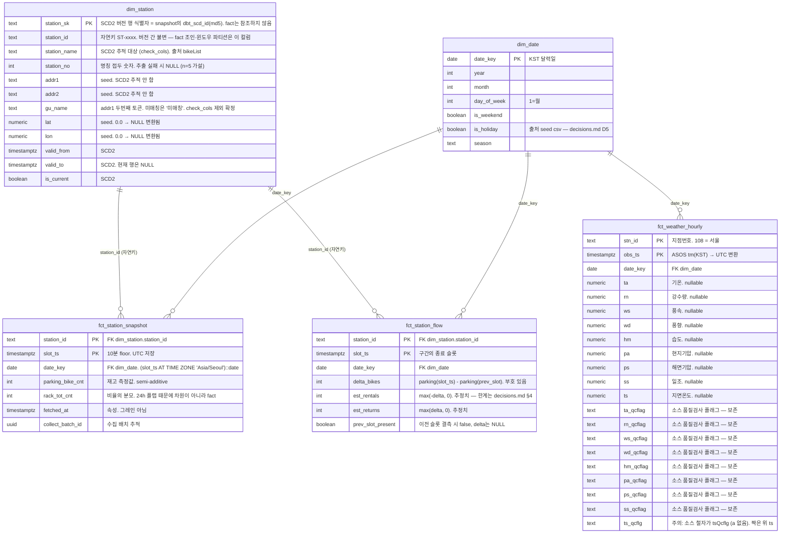
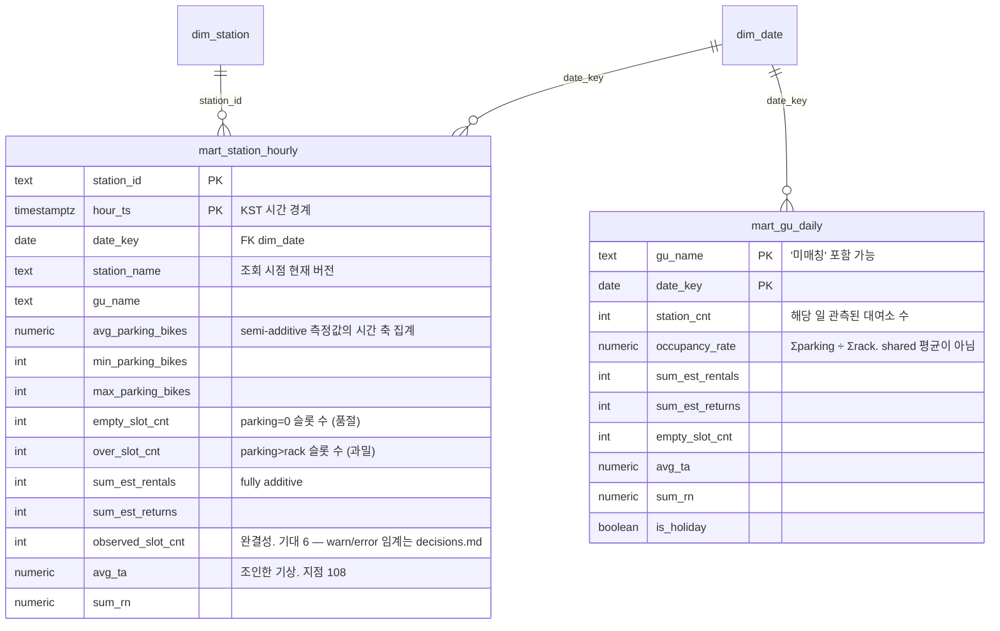

# ERD — 서울 공공자전거 + 기상 파이프라인

> **상태: 초안 (park98 작성, 미검수).** 이 문서의 모든 선택은 [결정 기록](decisions.md)에 선택지·트레이드오프와 함께 적혀 있습니다. 동의하지 않는 항목은 그쪽을 고치고 이 그림을 맞추세요 — 반대 순서면 그림에 맞춰 모델을 깎게 됩니다.
>
> **범위**: `dbt docs`가 lineage(모델 간 의존)를 자동 생성하므로, 이 ERD는 lineage를 중복하지 않고 **물리 키 · 카디널리티 · SCD2 유효기간 · 그레인**만 담습니다.

---

## 1. 그레인 선언 — 7개 모델 + staging + 랜딩

**그레인은 컬럼 튜플입니다.** 산문으로 적으면 유일성 테스트를 엉뚱한 컬럼에 걸게 됩니다.

| 계층 | 모델 | 그레인 (컬럼 튜플) | 유일성 테스트 | 가산성 | 결측 표현 |
|---|---|---|---|---|---|
| source | `raw.bike_status` | `(station_id, slot_ts)` | PK 제약 (멱등 적재의 근거) | — | 원문 보존 |
| source | `raw.weather_hourly` | `(stn_id, obs_ts)` | PK 제약 | — | 원문 보존 |
| staging | `stg_bike_status` | `(station_id, slot_ts)` | `unique_combination_of_columns` | — | `NULL` |
| staging | `stg_weather_hourly` | `(stn_id, obs_ts)` | `unique_combination_of_columns` | — | `NULL` (전 측정값 nullable) |
| staging | `stg_station_master` | `(station_id)` | `unique` + `not_null` | — | `NULL` (좌표 `0.0` → NULL 변환) |
| core | `dim_station` | `(station_sk)` · 자연키+유효기간 `(station_id, valid_from)` | 양쪽 모두 | (차원) | `'미매칭'` 버킷 (자치구) |
| core | `dim_date` | `(date_key)` — **KST 달력일** | `unique` + `not_null` | (차원) | 없음 (전 컬럼 NOT NULL) |
| core | `fct_station_snapshot` | `(station_id, slot_ts)` | `unique_combination_of_columns` | **semi-additive** → §3 | **행의 부재** |
| core | `fct_station_flow` | `(station_id, slot_ts)` | `unique_combination_of_columns` | **fully additive** | `delta = 0`도 행 생성 |
| core | `fct_weather_hourly` | `(stn_id, obs_ts)` | `unique_combination_of_columns` | 측정값별로 다름 → §3 | `NULL` + QC 플래그 |
| mart | `mart_station_hourly` | `(station_id, hour_ts)` | `unique_combination_of_columns` | 집계 결과 | 행의 부재 |
| mart | `mart_gu_daily` | `(gu_name, date_key)` | `unique_combination_of_columns` | 집계 결과 | 행의 부재 |

**`slot_ts`와 `fetched_at`은 다른 것입니다.** `slot_ts`는 10분으로 floor 한 **논리 슬롯**이고 그레인입니다. `fetched_at`은 실제 호출 시각이고 **속성**입니다. `bikeList` 응답에 관측시각 필드가 없으므로 `slot_ts`는 수집기가 계산해 넣습니다.

---

## 2. 코어 — 스타 스키마



**fact가 `station_sk`를 들고 있지 않습니다.** 설계서 원문은 `LAG(...) PARTITION BY station_sk`를 전제했는데, SCD2에서 `station_sk`는 버전마다 바뀌므로 명칭이 한 번 변경되면 그 대여소의 시계열이 **버전 경계에서 끊깁니다.** 그래서 fact는 불변 자연키 `station_id`를 들고, `station_sk`는 차원 행 식별자로만 둡니다. 근거와 대안은 [decisions.md D4](decisions.md).

---

## 3. 가산성 — 축별로 적습니다

"합산 금지"로 뭉개면 **대여소 간 합계라는 정당한 집계까지 금지**되고, `mart_gu_daily`가 자치구별로 무엇을 합산하는지 설명할 수 없게 됩니다.

| 측정값 | 분류 | 대여소 축 (같은 슬롯) | 시간 축 (같은 대여소) |
|---|---|---|---|
| `parking_bike_cnt` | **semi-additive** | ✅ 합산 가능 — 10:10 시점 서울 전체 거치 대수 | ❌ 금지. 144슬롯 합계는 같은 자전거를 144번 센 값. **평균·최대·최소·품절 슬롯 수**를 씁니다 |
| `rack_tot_cnt` | semi-additive | ✅ 합산 가능 (총 거치대 수) | ❌ 금지 — 같은 이유 |
| `delta_bikes` | **fully additive** | ✅ | ✅ |
| `est_rentals` / `est_returns` | **fully additive** | ✅ | ✅ |
| `ta` `hm` `ws` `wd` `pa` `ps` `ts` (기상 상태량) | **non-additive** | ❌ 지점 간 합산 무의미 | ❌ 평균만 유효 |
| `rn` (강수량) `ss` (일조) | fully additive | ❌ 지점 간 합산 무의미 | ✅ 시간 축 합산 가능 |

`parking_bike_cnt`(semi-additive)와 `est_rentals`(fully additive)를 한 표에 나란히 두면 그 자체가 **periodic snapshot fact와 transaction fact를 왜 분리했는지**의 설명입니다.

**`wd`(풍향)는 평균조차 그냥 내면 틀립니다.** 각도라서 350°와 10°의 산술 평균이 180°(정반대 방향)가 됩니다. 마트에서 쓸 일이 생기면 벡터 평균(sin·cos 성분 평균 후 `atan2`)으로 내거나, 방위 구간별 빈도로 집계하십시오. `avg(wd)`는 쓰지 마십시오.

**`shared`는 창고에 없습니다.** 소스가 계산해 준 `round(parking ÷ rack × 100)` 정수 비율이고, 저장하면 마트에서 재집계가 불가능해집니다 — 대여소 10곳의 평균 거치율은 `shared`의 평균이 아니라 `Σparking ÷ Σrack`입니다. `raw`에만 원문으로 남기고 staging에서 떨어뜨립니다. 비율은 분자·분모를 fact에 두고 마트에서 만듭니다.

---

## 4. 마트



**`mart_gu_daily`는 `dim_station`과 키로 연결되지 않습니다.** 자치구는 차원이 아니라 `dim_station`의 **속성**이고(`dim_gu`를 만들지 않기로 확정), `gu_name`은 `dim_station`에서 유일하지 않습니다 — 그래서 그림에 선을 그리지 않았습니다. 마트는 `dim_station`을 **집계한 결과**이고 그 의존은 `dbt docs`의 lineage에 나타납니다.

`occupancy_rate`는 **`rack_tot_cnt = 0`인 대여소를 분모에서 제외**하고 계산합니다. 대여소 단위에서 `rack = 0`이면 비율은 `0`이 아니라 **`NULL`**입니다 — "거치대가 없다"와 "거치율 0%"는 다른 사실이고, `0`으로 두면 자치구 평균을 끌어내립니다.

`accepted_range(0, 100)`을 거치율에 걸지 마세요. **`380%`를 실제로 관측했습니다** — 거치대보다 자전거가 많은 상태(재배치 직후·과밀)는 정상입니다. 범위 테스트를 걸면 정상 데이터에서 상시 실패합니다.

---

## 5. SCD2 유효기간 — 조인 규칙

ERD가 `dbt docs`와 구별되는 지점입니다.

```
현재 상태 조회        dim_station WHERE is_current
                     (대부분의 마트 조회는 이쪽)

시점 정합 조회        fct_station_snapshot f
                     JOIN dim_station d
                       ON f.station_id = d.station_id
                      AND f.slot_ts >= d.valid_from
                      AND (f.slot_ts < d.valid_to OR d.valid_to IS NULL)
                     (그 슬롯 당시의 명칭이 필요할 때만)

시계열 윈도우         ... OVER (PARTITION BY station_id ORDER BY slot_ts)
                     ← station_sk 아님. 끊깁니다
```

- `check_cols = [station_name]` **하나뿐**입니다. 자치구는 seed 재발행 노이즈 때문에 **무조건 제외**(확정 규칙), `rack_tot_cnt`는 24시간 안에 플랩하므로 차원이 아니라 fact 측정값입니다
- seed에서 오는 속성(주소·자치구·좌표)은 **SCD2 추적 대상이 아닙니다.** seed를 재발행하면 과거 행까지 덮어씁니다 — 이건 의도된 동작이고 모델 문서에 적습니다
- **"현재 운영중"은 소스가 주는 사실이 아닙니다.** 마스터에 운영상태 컬럼이 없고 신설·폐쇄는 `bikeList`의 등장·소멸로만 나타납니다. `is_active` = **최근 144슬롯(24h) 중 1회 이상 등장**으로 정의합니다. 이 숫자가 정의이므로 바꾸면 테스트의 의미가 바뀝니다

---

## 6. 멱등 적재 경로

```
Actions cron (10분)
  └─ bikeList 3페이지 호출 → slot_ts = floor(now_utc, 10min)
     └─ 3페이지 전부 성공해야 커밋 (부분 수집은 커밋하지 않음)
        └─ S3 raw JSON.gz : s3://.../bike/dt=YYYY-MM-DD/slot=HHMM/page=N.json.gz

로더 (Airflow)
  └─ S3 → COPY → TEMP 테이블
     └─ INSERT INTO raw.bike_status SELECT … FROM tmp
        ON CONFLICT (station_id, slot_ts) DO NOTHING
```

**같은 구간을 두 번 적재해도 결과가 같다**는 근거가 `raw.bike_status`의 PK `(station_id, slot_ts)`와 `DO NOTHING`입니다. 두 번째 적재의 `INSERT` 영향 행수가 **0**이라는 것이 멱등성의 측정값입니다.

**`DO NOTHING`은 먼저 쓴 행이 이깁니다.** 그래서 **부분 수집을 로더가 애초에 커밋하지 않는 것**이 이 선택의 전제입니다 — 3페이지 중 1페이지만 성공한 스냅샷이 먼저 들어가면 더 나쁜 관측이 영구히 남습니다. 대안(나중 것이 이기는 `DO UPDATE`)과 트레이드오프는 [decisions.md D2](decisions.md).

---

## 7. 이 문서가 다루지 않는 것

- **lineage** — `dbt docs generate`가 만듭니다. 여기서 중복하지 않습니다
- **`schema.yml` 테스트 본문** — 작성 완료입니다. staging·intermediate·core 는 `dbt/models/*/schema.yml`, 아직 모델이 없는 core fact·mart 는 [schema-tests.planned.yml](schema-tests.planned.yml)에 미리 써 뒀습니다. **테스트가 데이터보다 먼저 커밋돼 있어야 합니다** (커밋 순서가 증거)
- **ASOS 실응답** — 결측 표현(`null` / `""` / `-`)과 QC 플래그 값 분포는 키 발급 후 확인합니다. 그레인·키·가산성은 이 값에 걸려 있지 않습니다
- **전수 재확인 4건** — `shared` 공식 / `rack = 0` 존재 여부 / 마스터 좌표 `0.0` 건수 / 명칭 접두 추출 성공률. 전부 **n=5 표본**에서 나온 관측입니다
